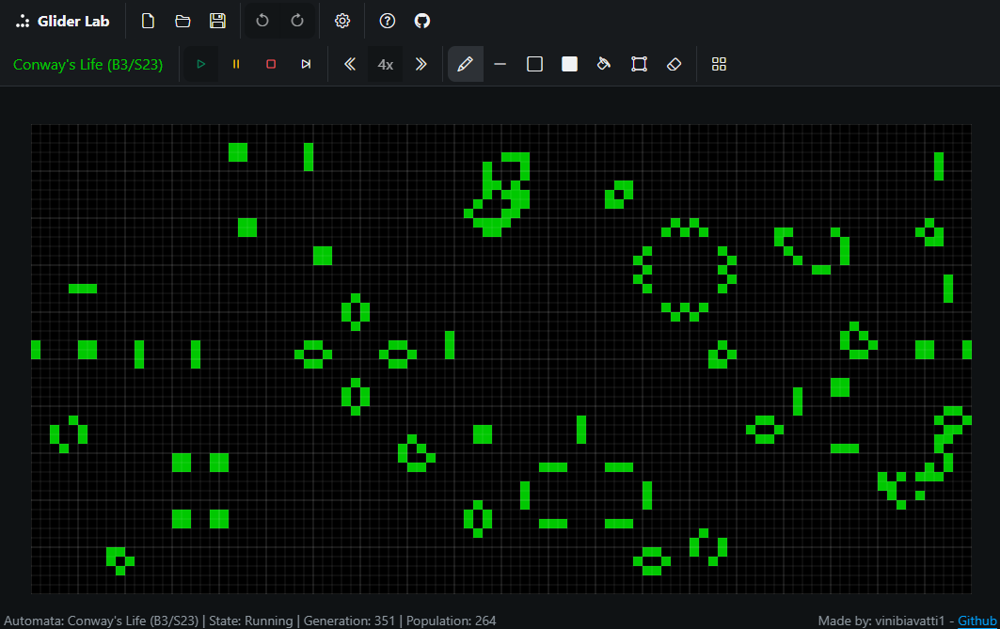
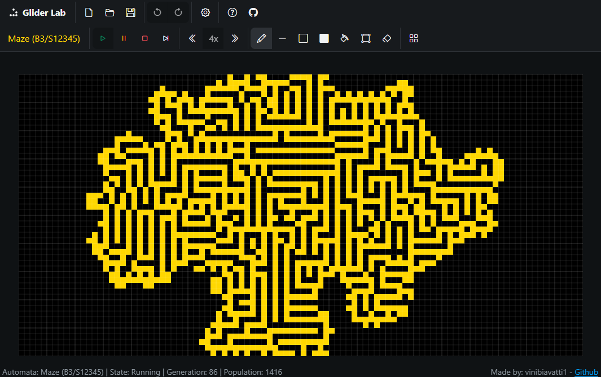
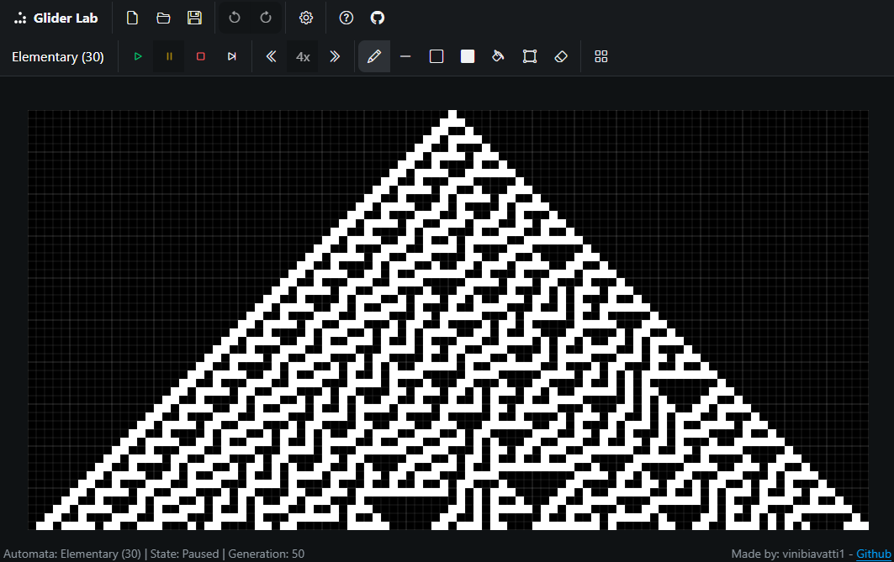
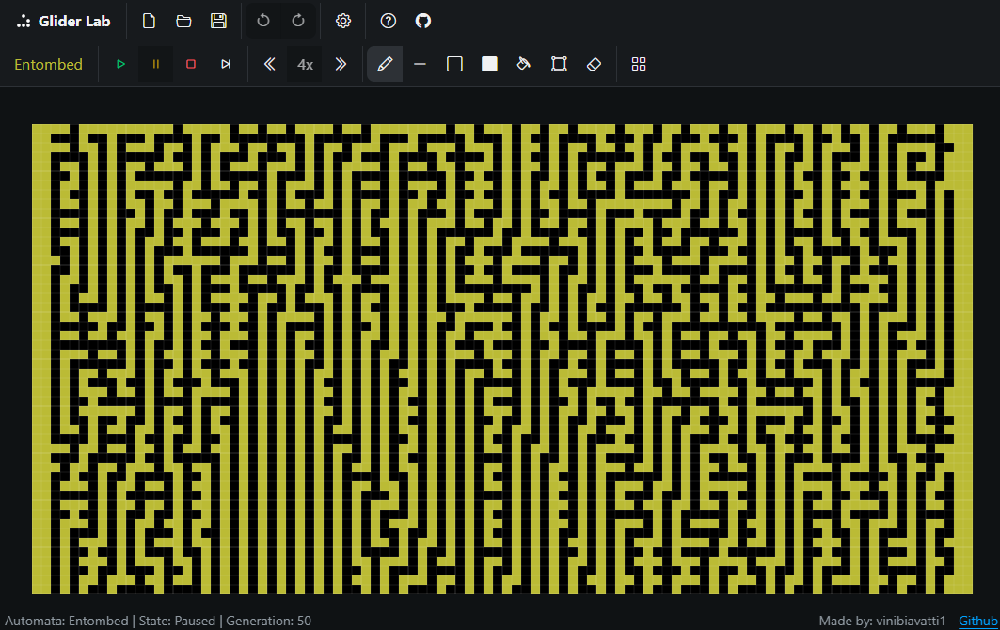
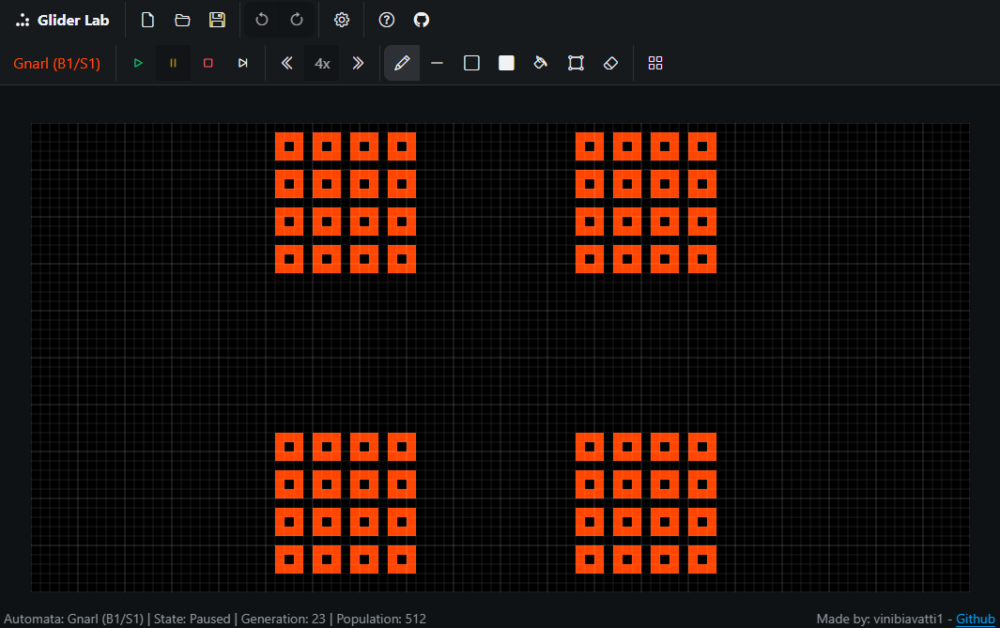
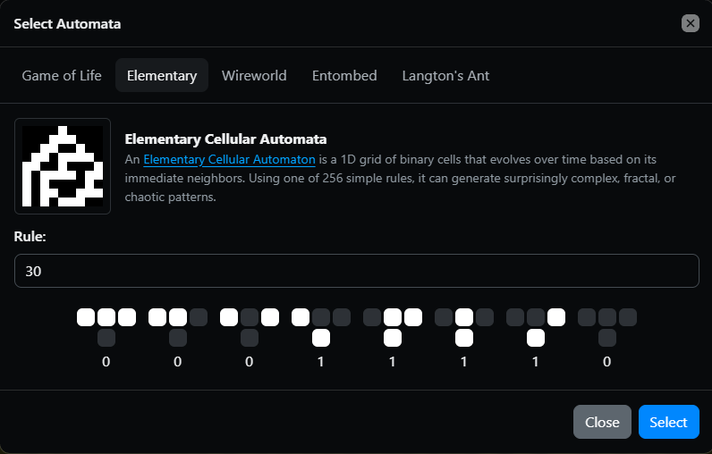

    
    <h1 align="center">Glider Lab</h1>
    
Interactive Cellular Automata Playground.

    <h3 align="center"><a href="https://vinibiavatti1.github.io/GliderLab/" target="_blank">✨ Try Glider Lab Live -- Playground ✨</a></h3>

## 📌 About

**Glider Lab** is an interactive playground built in vanilla JavaScript for exploring cellular automata, emergent behaviors, and historic procedural generation algorithms. 

Designed with a clean, retro-modern interface, it allows you to draw on the grid, test spaceships, simulate complex logic circuits, and run classic cellular rules in real time right inside your browser.

## 🧬 What are Cellular Automata?

Cellular automata are discrete models studied in computability theory, mathematics, and theoretical biology. Consisting of a grid of cells in various states, they evolve through a set of recursive rules based on the states of neighboring cells. 

Despite their simple local rules, they can give rise to complex, unpredictable, and Turing-complete global behaviors—demonstrating how intricate patterns emerge from basic underlying mathematics.

## 🚀 Key Features & Showcases

* **Game of Life & Spaceships:** Experiment with Conway's Game of Life, complete with utility-based rotation tools for classic patterns like Gliders and Lightweight Spaceships (LWSS).
* **Wireworld:** A specialized automaton created by Brian Silverman in 1987 to simulate electronic circuits, logical gates, and digital architecture using four distinct cell states.
* **Interactive Tools:** Full drawing support, grid customization, step-by-step controls, and buffer optimization.
* And much more!

## 🛠️ Tech Stack

* HTML5 & CSS3
* JavaScript (ES6+)
* [Bootstrap](https://getbootstrap.com/)

## 📸 Screenshots

    
    

    
    

    
    

## 📄 License

This project is open-source and available under the [MIT License](LICENSE).
